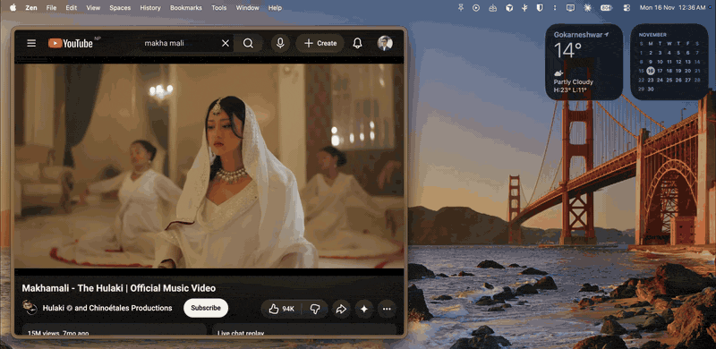

<p align="center">
  
</p>

<h1 align="center">Pin To Top</h1>

<p align="center">
  Picture-in-picture for video calls on your Mac, even over full-screen apps.
</p>

<p align="center">
  <a href="#install"><b>Install</b></a>
  ·
  <a href="https://github.com/Abhishek-programs/PinToTop/releases/latest/download/PinToTop.dmg">Download the DMG</a>
  ·
  <a href="https://bhattaraiabhishek.com.np/apps/pintotop">Website</a>
  ·
  <a href="#how-it-works">How it works</a>
</p>

<p align="center">
  
  
  
  <a href="LICENSE"></a>
</p>

Pin your FaceTime, Zoom, Meet, or Teams window and a live, view-only copy floats on top of everything else: in every Space and over most full-screen apps. Works with any other app window too.

Typical use: you're on a video call, but you need to work in a full-screen editor or browser. Pin the call window and a small live mirror stays in the corner while you work.



## What it does

- Lists your open app windows (per display, with live thumbnails) from the menu bar or the main window.
- **Pin** a window and it gets mirrored into a small floating panel on the display you're using. Drag it to another display if you like.
- Turn on **Show on all displays** to get a copy on every connected screen instead. You can switch while pinned.
- Turn on **Launch at login** to have it waiting in the menu bar after every restart.
- The panel follows you across Spaces and into full-screen app Spaces where macOS allows it.
- **Unpin** from the menu bar or main window, or just close the floating panel, to stop capture.

It is a *mirror*, not a window manager. The original window stays where it is. You can't click through the mirror; use the source app for controls (mute, leave call, and so on).

## Requirements

- macOS 14 (Sonoma) or later
- Apple Silicon

## Install

### One-line install (no security warning)

Paste this in Terminal:

```bash
curl -fsSL https://raw.githubusercontent.com/Abhishek-programs/PinToTop/main/install.sh | zsh
```

It downloads the latest release, puts Pin To Top in **Applications**, and opens it. [Read the script first](install.sh) if you like; it's short. Files downloaded with `curl` aren't flagged by macOS, so you skip the "can't verify" dialog.

### Download the DMG

1. Download **[PinToTop.dmg](https://github.com/Abhishek-programs/PinToTop/releases/latest/download/PinToTop.dmg)** and drag Pin To Top into **Applications**.
2. Open it. macOS will say it can't verify the app. Click **Done**, *not* Move to Trash.
3. Go to **System Settings → Privacy & Security**, scroll down, and click **Open Anyway**. Confirm with your password or Touch ID.

Why the warning? The app is free and isn't notarized with a paid Apple Developer ID yet, so macOS can't confirm who made it. You only do this once.

### After installing

Grant **Screen Recording** when asked (see [Permissions](#permissions)). After an update, macOS may ask again.

### Build from source

Needs the Xcode Command Line Tools (`xcode-select --install`).

```bash
git clone https://github.com/Abhishek-programs/PinToTop.git
cd PinToTop
./build-app.sh
open "outputs/Pin To Top.app"
```

`./make-dmg.sh` builds the app and packs it into `outputs/PinToTop.dmg`.

The build is **ad-hoc signed** and **not notarized**. That's fine on the machine that built it.

### Stable signing (optional, recommended if you rebuild often)

macOS ties the Screen Recording permission to the app's code signature. With ad-hoc signing every rebuild looks like a new app, so you may have to grant permission again. If you have an Apple Development certificate, sign with it:

```bash
CODESIGN_IDENTITY="Apple Development: Your Name (TEAMID)" ./build-app.sh
```

List your identities with `security find-identity -v -p codesigning`.

## Permissions

Pin To Top needs **Screen Recording** permission. That's how macOS lets any app capture another app's window.

- On first launch macOS shows the system prompt. Grant it in **System Settings → Privacy & Security → Screen & System Audio Recording**, then reopen the app.
- The app asks at most once per launch. If you deny it, nothing else is captured and it won't nag you.
- **Video only.** Audio capture is explicitly disabled, and the app never asks for microphone access.
- **Local only.** Frames stay in memory and are drawn to the overlay. Nothing is written to disk or sent over the network.

## How it works

About 1,400 lines of Swift, no dependencies.

| Piece | Implementation |
|---|---|
| Window list | `SCShareableContent` (onscreen only), filtered to normal-layer windows of regular apps, assigned to displays by frame intersection |
| Thumbnails | `SCScreenshotManager.captureImage`, max 2 concurrent captures through a small actor gate |
| Live capture | One `SCStream` per pinned window via `SCContentFilter(desktopIndependentWindow:)`, up to 30 fps, cursor hidden, audio off |
| Overlay | Non-activating `NSPanel` at `.statusBar` level with `.canJoinAllSpaces` + `.fullScreenAuxiliary`, re-raised on Space changes. One panel on the display under the pointer, or one per display with **Show on all displays**; all panels share one stream. |
| Launch at login | `SMAppService.mainApp` register/unregister; the switch reads the live status, so changes made in System Settings → Login Items show up too |
| Permission | `CGPreflightScreenCaptureAccess` before every ScreenCaptureKit call, so background refreshes never trigger the system prompt |

[PRD.md](PRD.md) has the full requirements and design notes.

## Known limits

- The source window must stay open and **not minimized**. Minimized windows can't be captured.
- macOS decides which full-screen Spaces accept overlays. Secure surfaces (login window, some protected video, certain system UI) will cover the mirror. No third-party app can override that.
- Apps that use unusual window levels may not show up in the list (the filter is deliberately conservative).
- Apple Silicon only. The download isn't notarized yet, so the DMG needs **Open Anyway** on first launch, or use the [one-line install](#install).
- Early software, tested on a small number of setups. Bug reports with your macOS version and the source app are very welcome.

## Roadmap to a proper release

- [ ] Developer ID signing + hardened runtime
- [x] Downloadable `.dmg`
- [ ] Notarization
- [ ] Universal binary (Apple Silicon + Intel)
- [ ] Compatibility matrix (macOS versions × common call/video apps)

## Later

- [ ] **Interactive pin mode** (opt-in): keep the *real* window on top in place so you can click and type into it, alongside the picture-in-picture mirror. Needs Accessibility permission, so it must stay opt-in.

## Contributing

Issues and PRs are welcome. See [CONTRIBUTING.md](CONTRIBUTING.md).

## License

[MIT](LICENSE)
